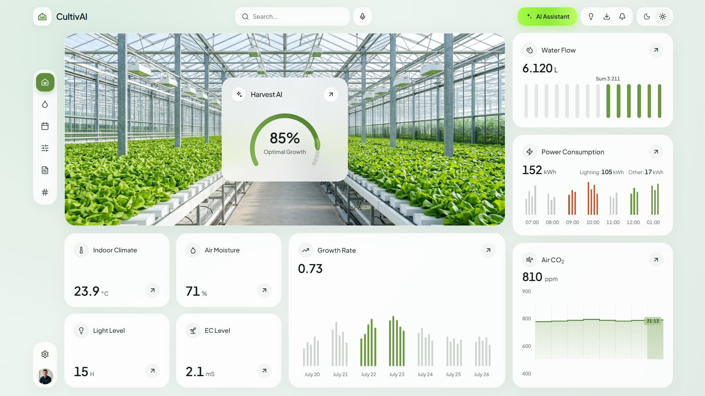
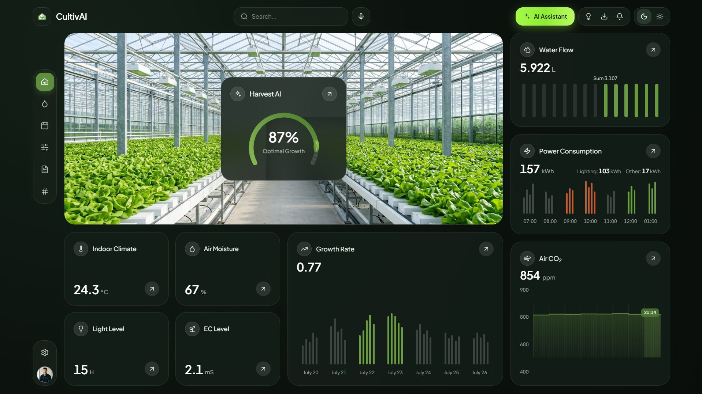
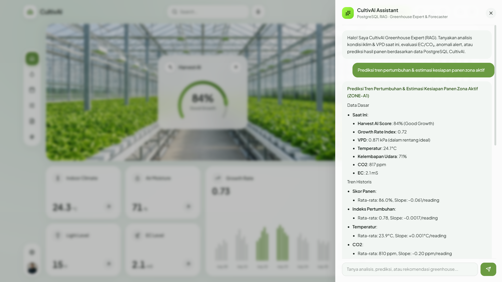
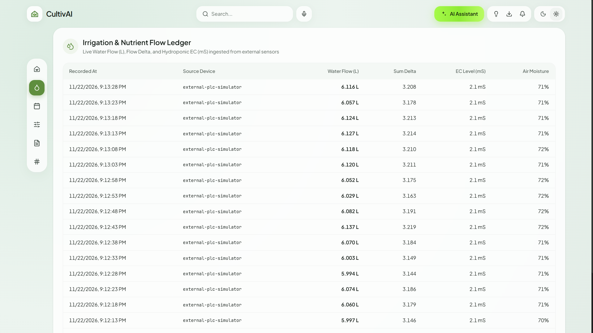
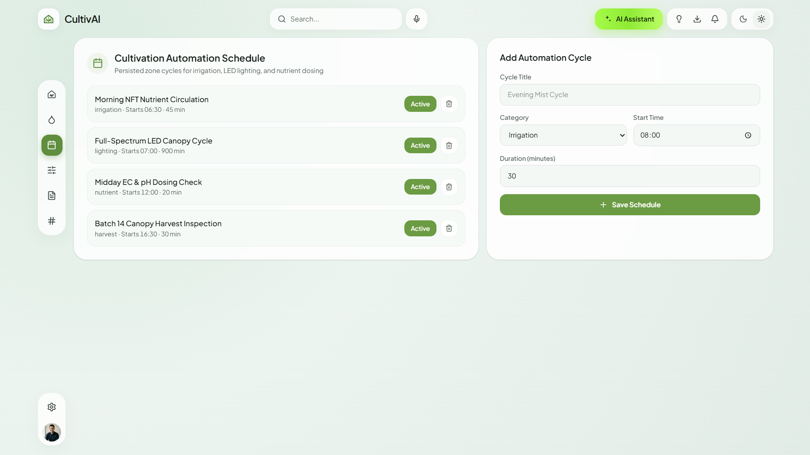
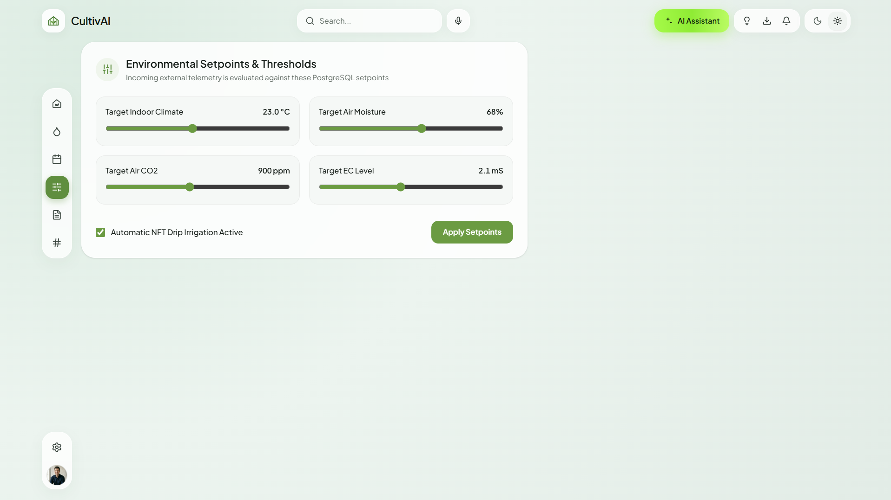
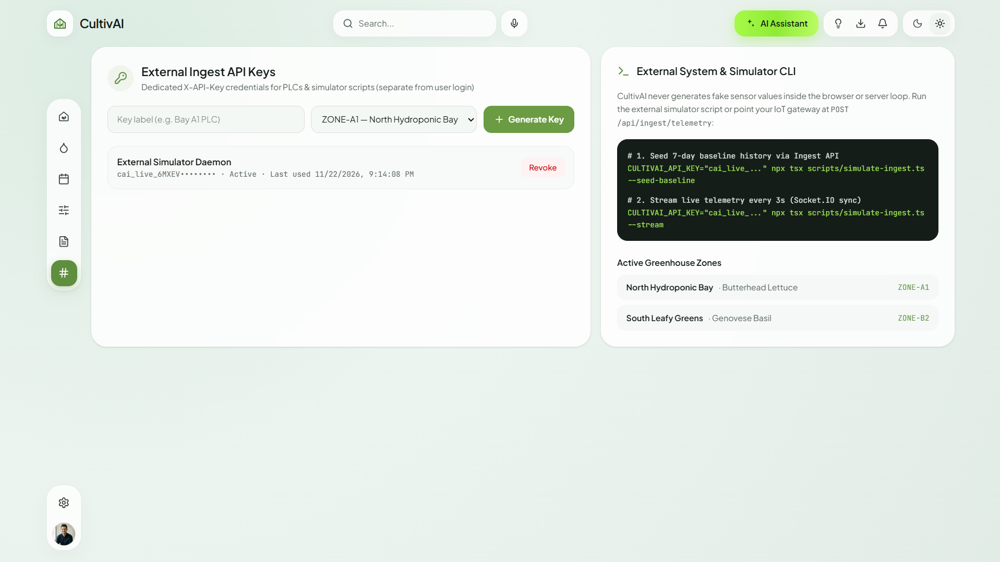
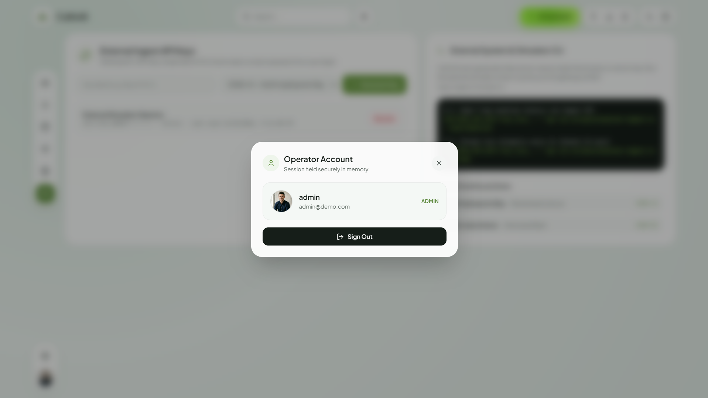
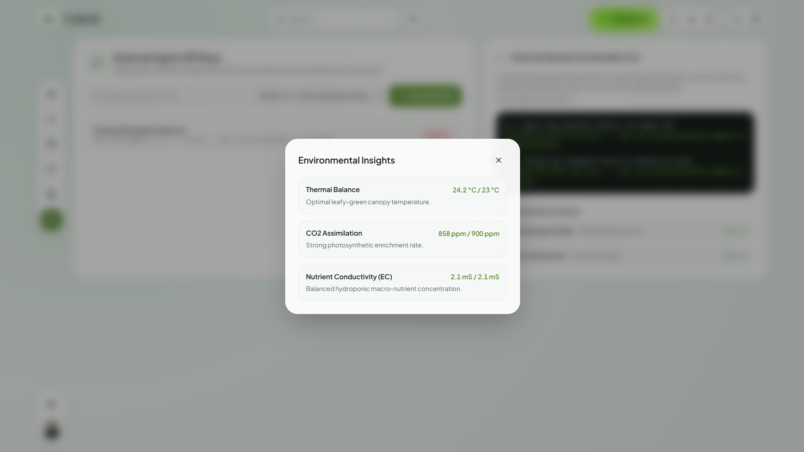
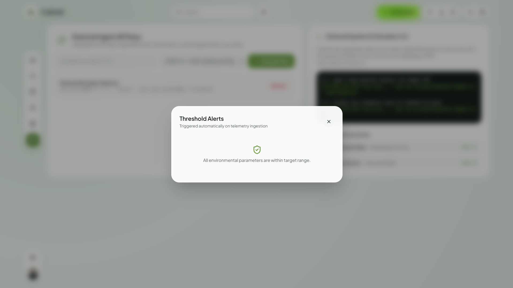

<div align="center">

# CultivAI

**Real-Time Hydroponic Greenhouse Telemetry, IoT Ingestion, and RAG AI Agronomy Platform**

[](https://react.dev/)
[](https://www.typescriptlang.org/)
[](https://tailwindcss.com/)
[](https://expressjs.com/)
[](https://socket.io/)
[](https://www.postgresql.org/)
[](https://orm.drizzle.team/)
[](/api/docs)
[](#apps-system-architecture)

</div>

---

## Visual Overview

<p align="center">
  
</p>

<table>
  <tr>
    <td width="33%" align="center">
      <br />
      <sub><strong>Dark Mode Dashboard</strong></sub>
    </td>
    <td width="33%" align="center">
      <br />
      <sub><strong>CultivAI RAG Assistant</strong></sub>
    </td>
    <td width="33%" align="center">
      <br />
      <sub><strong>Irrigation & Nutrient Flow Ledger</strong></sub>
    </td>
  </tr>
  <tr>
    <td width="33%" align="center">
      <br />
      <sub><strong>Cultivation Automation Schedule</strong></sub>
    </td>
    <td width="33%" align="center">
      <br />
      <sub><strong>Environmental Setpoints & Thresholds</strong></sub>
    </td>
    <td width="33%" align="center">
      <br />
      <sub><strong>External Ingest API Keys & CLI</strong></sub>
    </td>
  </tr>
  <tr>
    <td width="33%" align="center">
      <br />
      <sub><strong>Operator Account Session</strong></sub>
    </td>
    <td width="33%" align="center">
      <br />
      <sub><strong>Environmental Insights</strong></sub>
    </td>
    <td width="33%" align="center">
      <br />
      <sub><strong>Threshold Alerts</strong></sub>
    </td>
  </tr>
</table>

---

## Project Structure

```text
cultivai/
├── docs/                                # Documentation & README screenshots
│   ├── screen_cultiveai_main.png        # Main dashboard (Light mode)
│   └── screen_cultiveai_1..9.png        # Dark mode, RAG drawer, secondary views & modals
├── scripts/
│   └── simulate-ingest.ts               # External IoT/PLC simulator CLI targeting /api/ingest/*
├── src/
│   ├── assets/images/                   # Bundled greenhouse hero & operator avatar images
│   ├── components/
│   │   ├── Charts.tsx                   # Water Flow, Power Consumption, Growth Rate, Air CO2 charts
│   │   ├── HarvestAiGauge.tsx           # Floating frosted-glass Harvest AI semicircular gauge
│   │   ├── Modals.tsx                   # Auth, Metric Detail, RAG AI Drawer, Alerts, Insights modals
│   │   └── SecondaryViews.tsx           # Ledger, Schedule, Controls, Logs/Swagger, Zones & API Keys
│   ├── db/
│   │   ├── index.ts                     # Split DB_* postgres-js client (PgBouncer compatible)
│   │   └── schema.ts                    # Drizzle ORM PostgreSQL schema (7 tables)
│   ├── server/
│   │   ├── auth.ts                      # Scrypt hashing, HMAC-SHA256 JWT, SHA-256 API Key guards
│   │   ├── ragAssistant.ts              # PostgreSQL RAG retriever (VPD, slopes) + OpenAI client
│   │   ├── swagger.ts                   # OpenAPI 3.0.3 specification builder
│   │   └── telemetryService.ts          # Ingestion validation, alert evaluation, overview & CSV export
│   ├── types/
│   │   └── telemetry.ts                 # Shared TypeScript contracts across client & server
│   ├── App.tsx                          # Bento grid dashboard, Socket.IO listener & view router
│   ├── index.css                        # Tailwind CSS v4 theme & custom scrollbar/typography rules
│   └── main.tsx                         # React entry point
├── drizzle.config.ts                    # Drizzle Kit configuration using split DB_* variables
├── index.html                           # Root HTML template with SEO & font imports
├── metadata.json                        # Application metadata manifest
├── package.json                         # Scripts & dependencies
├── server.ts                            # Express + Socket.IO + Swagger + Vite/dist server entry
├── tsconfig.json                        # TypeScript configuration
├── vite.config.ts                       # Vite + Tailwind v4 + static asset copy plugin
└── .env.example                         # Environment variable template (no secrets)
```

---

## Apps System Architecture

CultivAI strictly separates **external sensor ingestion**, **user application access**, **real-time WebSocket delivery**, and **database-grounded AI agronomy reasoning**:

```text
┌───────────────────────────┐        X-API-Key (SHA-256)        ┌───────────────────────────────────────┐
│ External PLC / IoT Sensor │ ─────────────────────────────────▶ │ Express Ingestion API (/api/ingest/*) │
│ or scripts/simulate-ingest│    POST /telemetry | /batch        │  • Payload validation                 │
└───────────────────────────┘                                    │  • Zone threshold alert evaluation    │
                                                                 └───────────────────┬───────────────────┘
                                                                                     │
                                                                 ┌───────────────────▼───────────────────┐
                                                                 │     PostgreSQL + Drizzle ORM          │
                                                                 │  • telemetry_readings  • alerts       │
                                                                 │  • greenhouse_zones    • api_keys     │
                                                                 │  • zone_thresholds     • users        │
                                                                 │  • zone_schedules                     │
                                                                 └───────┬───────────────────────┬───────┘
                                                                         │                       │
         Socket.IO (telemetry:new / telemetry:batch / zone:updated)      │                       │ RAG Context Retrieval
         ◀───────────────────────────────────────────────────────────────┘                       │ (60 rows, VPD, slopes)
         │                                                                                       ▼
┌────────▼──────────────────┐     Authorization: Bearer JWT     ┌────────────────────────────────────────┐
│   React 19 Dashboard SPA  │ ────────────────────────────────▶ │ Express App API & RAG Assistant Engine │
│  • Live Bento telemetry   │   /api/telemetry/*, /api/zones,   │  • /api/ai/assistant -> AI_BASE_URL    │
│  • Markdown AI Drawer     │   /api/keys, /api/schedules, etc. │  • /api/docs -> Swagger UI (OpenAPI)   │
└───────────────────────────┘                                   └────────────────────────────────────────┘
```

### Core Architectural Highlights

1. **Strict Auth Isolation**
   - **Operator Authentication (`Authorization: Bearer <JWT>`)**: Scrypt password hashing with HMAC-SHA256 stateless JWTs held strictly in React state memory (no `localStorage` or cookies). First-run registration automatically claims the initial `admin` seat via `/api/auth/bootstrap-status`.
   - **External Ingest Authentication (`X-API-Key: cai_live_...`)**: Machine-to-machine API keys stored as SHA-256 hashes in PostgreSQL (`api_keys`). User JWTs are rejected on `/api/ingest/*`, and ingest API keys are rejected on user endpoints.
2. **Zero Synthetic Browser/Server Loops**
   - Telemetry enters exclusively through `/api/ingest/telemetry` or `/api/ingest/batch`. The standalone CLI (`scripts/simulate-ingest.ts`) acts as an external gateway client over HTTP.
3. **Instant Socket.IO Synchronization**
   - Validated ingestion writes persist to PostgreSQL and immediately emit `telemetry:new`, `telemetry:batch`, and `zone:updated` events to subscribed browser rooms (`telemetry:live` and `zone:<id>`).
4. **PostgreSQL RAG + OpenAI-Compatible Expert Assistant**
   - `POST /api/ai/assistant` retrieves up to 60 recent zone readings, calculates **Magnus-Tetens Vapor Pressure Deficit (VPD)** in `kPa` and linear regression slopes for Harvest AI, Growth Rate, Temperature, CO₂, EC, and Water Flow, appends active alerts, schedules, and cross-zone snapshots, and queries any OpenAI-compatible `/chat/completions` provider (`AI_KEY`, `AI_BASE_URL`, `AI_MODEL`).
5. **Interactive OpenAPI Documentation**
   - Self-hosted Swagger UI is served at `/api/docs` (with raw spec at `/api/openapi.json`) and embedded inside the **Logs & API Docs** view.

---

## Tech Stack

| Layer | Technology | Purpose |
| :--- | :--- | :--- |
| **Frontend** | React 19, TypeScript, Vite 8 | Modular SPA dashboard & responsive layouts |
| **Styling & UI** | Tailwind CSS v4, Lucide React, Motion | Frosted glassmorphism, light/dark themes, micro-interactions |
| **Markdown** | `react-markdown`, `remark-gfm` | Rich rendering of AI agronomy tables, lists, and recommendations |
| **Backend** | Node.js, Express 4, `esbuild` | Unified HTTP server, REST API, rate limiting & production bundling |
| **Real-Time** | Socket.IO 4.8 | Sub-second bi-directional telemetry push to connected clients |
| **Database & ORM** | PostgreSQL (Supabase), Drizzle ORM, `postgres-js` | Type-safe relational schema & PgBouncer-compatible pooling (`prepare: false`) |
| **AI Integration** | OpenAI-Compatible Chat Completions API | Configurable server-side LLM inference grounded in PostgreSQL RAG |
| **API Docs** | `swagger-ui-express` (OpenAPI 3.0.3) | Interactive REST integration documentation at `/api/docs` |

---

## How to Build

### 1. Prerequisites

- **Node.js** `>= 20.x`
- **PostgreSQL** database (e.g., Supabase PostgreSQL pooler or self-hosted PostgreSQL)
- An **OpenAI-compatible LLM API** endpoint & key (for the CultivAI Assistant)

### 2. Install Dependencies

```bash
npm install
```

### 3. Configure Environment Variables

Copy `.env.example` to `.env` and populate the split database, auth, and AI configuration variables:

```bash
cp .env.example .env
```

```env
# PostgreSQL connection parameters (split parameters, no DATABASE_URL needed)
DB_HOST="your-postgres-host"
DB_PORT="5432"
DB_NAME="postgres"
DB_USER="your-postgres-user"
DB_PASSWORD="your-postgres-password"
DB_SSL="true"

# Optional HMAC signing secret for user JWT sessions
AUTH_SECRET="replace-with-a-strong-random-secret"

# OpenAI-Compatible AI Assistant Configuration (Server-Side Only)
AI_KEY="your-openai-compatible-api-key"
AI_BASE_URL="https://api.openai.com/v1"
AI_MODEL="gpt-4o-mini"
```

### 4. Push Database Schema

Push the 7 Drizzle ORM tables (`users`, `greenhouse_zones`, `api_keys`, `telemetry_readings`, `alerts`, `zone_schedules`, `zone_thresholds`) to PostgreSQL:

```bash
npm run db:push
```

### 5. Run in Development & Ingest Telemetry

Start the unified Vite + Express + Socket.IO development server on port `3000`:

```bash
npm run dev
```

Register your initial Admin account in the UI, generate an **External Ingest API Key** in the **Zones & Keys (`#`)** tab, and run the external simulator CLI to seed 7-day baseline data and stream live readings:

```bash
# Seed baseline history via POST /api/ingest/batch
CULTIVAI_API_KEY="cai_live_your_key_here" npm run simulate -- --seed-baseline

# Stream live telemetry every 3 seconds via POST /api/ingest/telemetry
CULTIVAI_API_KEY="cai_live_your_key_here" npm run simulate -- --stream
```

### 6. Build for Production

Type-check and compile both the Vite frontend bundle (`dist/`) and the standalone ESM server bundle (`dist/server.mjs`):

```bash
npm run lint
npm run build
```

---

## How to Deploy

### 1. Start the Production Server

The build step bundles `server.ts` into `dist/server.mjs` using `esbuild` so production execution runs directly on `node` without needing `tsx` or `vite` dev tooling at runtime:

```bash
npm start
# Executes: NODE_ENV=production node dist/server.mjs
```

By default, the server listens on `PORT=3000` (overridable via `process.env.PORT`).

### 2. Required Production Environment Variables

Configure these secrets in your hosting provider (Cloud Run, Railway, Fly.io, Render, or Docker/VPS):

| Variable | Required | Description |
| :--- | :---: | :--- |
| `DB_HOST`, `DB_PORT`, `DB_NAME`, `DB_USER`, `DB_PASSWORD`, `DB_SSL` | Yes | Split PostgreSQL credentials (`DB_SSL="true"` for managed Postgres/Supabase) |
| `AUTH_SECRET` | Recommended | Persistent HMAC-SHA256 secret so user JWTs survive server restarts/replicas |
| `AI_KEY`, `AI_BASE_URL`, `AI_MODEL` | Yes (for AI) | Server-side credentials for the OpenAI-compatible RAG AI Assistant |
| `PORT` | Optional | Listening HTTP port (defaults to `3000`) |

### 3. Reverse Proxy & Verification

- **WebSockets (`/socket.io`)**: Ensure your reverse proxy (Nginx, Caddy, Cloudflare, or Cloud Run) forwards `Upgrade` and `Connection: upgrade` headers so Socket.IO upgrades cleanly to WebSockets (`app.set('trust proxy', 1)` is already enabled).
- **Health Check**: Probe `GET /api/health` (`200 OK`, returns `{ status: "ok", databaseConfigured: true }`).
- **API & Integration Docs**: Verify interactive Swagger UI at `/api/docs` and OpenAPI JSON at `/api/openapi.json`.
